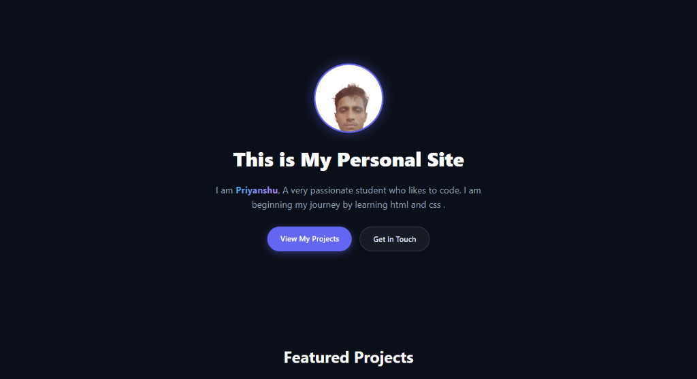

# Priyanshu's Personal Portfolio 

## About This Site
My name is Priyanshu, and this is my personal portfolio website built with plain HTML and CSS to show my projects and help teach my classmates. The site includes a basic profile section, a grid layout for my featured projects, and contact links, all written from scratch without any frameworks to keep the code simple to read. You can test it by opening the index.html file in your browser, and feel free to reach out to me on GitHub at @priyanshusingh1234 or email at kpk22128@gmail.com.



## Notes & Known Issues
This site contain images which i took from internet as i am planning to replace them later. On my projects section one card has a bug as it does not redirect to external site . I still could not fix that but i am trying.

I will add more features in this later .

## How to Run This Project

You can run this website on your computer in two simple ways:

### Method 1: Direct in Browser (Quickest)
1. Clone or download this repository to your computer.
2. Find the `index.html` file in your folder.
3. Simply double-click `index.html` (or right-click Open with Chrome / Edge).
4. The website will open immediately with no setup needed!

### Method 2: Local Server (Optional)
If you prefer to run a local development server:
```bash
python -m http.server 8000
`
Then visit `http://localhost:8000` in your browser.

---

Thank you!!
